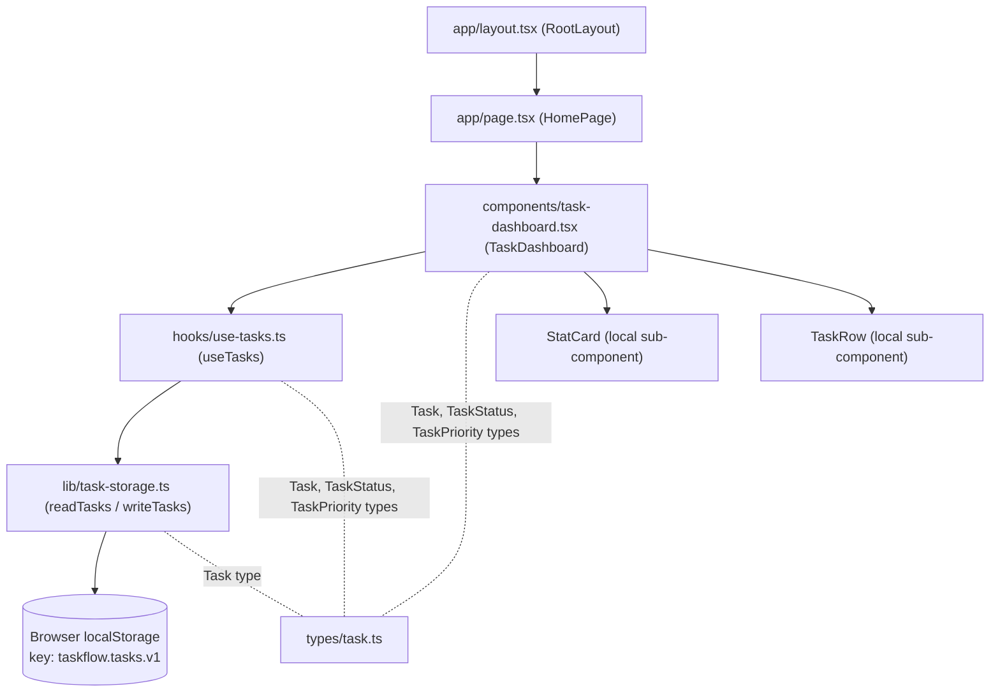
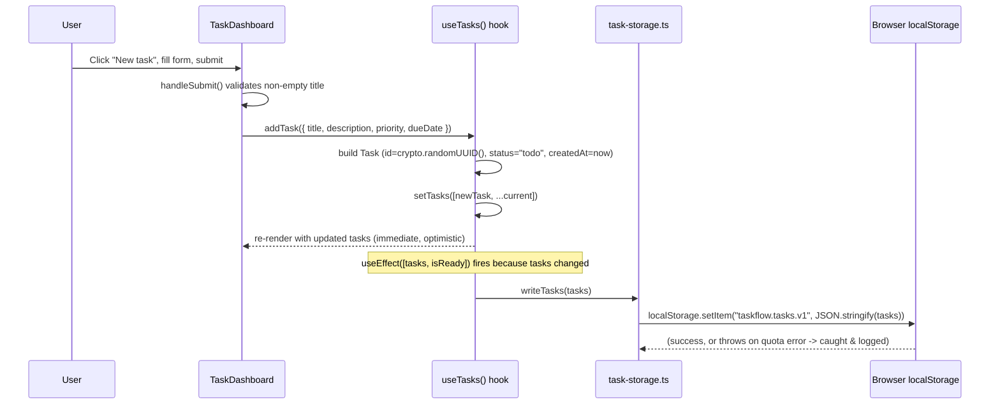
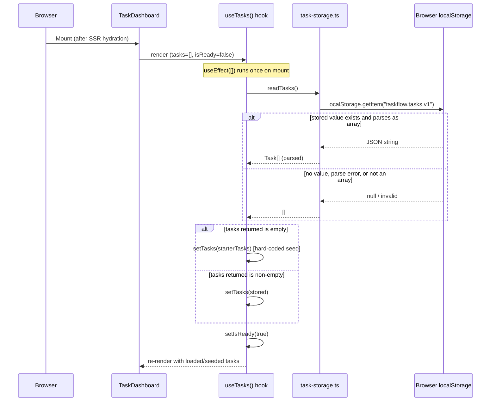
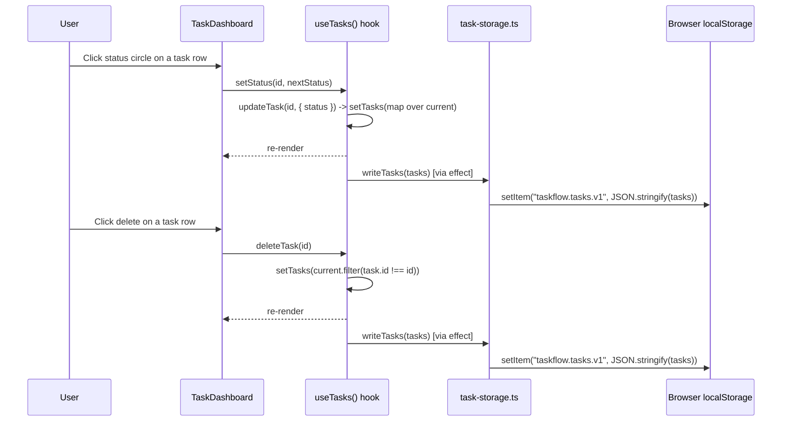

# Architecture Analysis

## System Overview

TaskFlow is a single-page, client-rendered Next.js (App Router) application with no backend of its own. It consists of one route (`/`) that renders a single top-level client component (`TaskDashboard`), a custom React hook (`useTasks`) that owns all task state, and a thin persistence module (`task-storage.ts`) that reads/writes the browser's `localStorage`. There are no API routes, no server actions, no database, and no external network calls anywhere in the codebase.

## Architectural Style

**Client-rendered monolithic single-page app, backend-free.** Evidence:
- `src/app/page.tsx` renders only `<TaskDashboard />`, a component marked `"use client"` in `src/components/task-dashboard.tsx` — the entire interactive UI is client-side.
- No `src/app/api/` directory, no route handlers, no server actions (`"use server"`) anywhere in `src/`.
- All state lives in a single `useTasks()` hook instance held by `TaskDashboard`; there is no global store, context provider, or state-management library (no Redux/Zustand/Jotai/etc. in dependencies).
- Persistence is entirely client-side via the Web Storage API (`localStorage`), not a server-backed database.

This is a layered-but-flat structure rather than a classic multi-service architecture: UI layer (`components/`) → state/hook layer (`hooks/`) → persistence layer (`lib/`) → browser storage, with a shared `types/` module cutting across all three.

## Component Relationships

Text fallback: `RootLayout` wraps `HomePage`, which renders `TaskDashboard`. `TaskDashboard` consumes the `useTasks` hook for all task data and mutation functions, and renders two small local sub-components (`StatCard`, `TaskRow`) defined in the same file. `useTasks` delegates reading and writing the task list to `task-storage.ts`, which is the only module that touches `window.localStorage`, under the fixed key `taskflow.tasks.v1`. `types/task.ts` supplies the shared `Task`, `TaskStatus`, and `TaskPriority` types consumed by all three layers (components, hook, storage).

## Data Flow

1. On first render (server-side, since Next.js renders `TaskDashboard`'s initial pass on the server before hydration), `useTasks()` initializes `tasks` to `[]` and `isReady` to `false` — the SSR-safe default, since `window`/`localStorage` do not exist on the server.
2. After the component mounts in the browser, a `useEffect` runs once: it calls `readTasks()`, which reads and JSON-parses `localStorage["taskflow.tasks.v1"]`. If nothing is stored (first visit, or storage cleared), the hook falls back to a hard-coded `starterTasks` seed array. Either way, `isReady` flips to `true`.
3. A second `useEffect`, gated on `[tasks, isReady]`, calls `writeTasks(tasks)` whenever `tasks` changes — but only once `isReady` is `true`, so the initial empty-array state never overwrites existing stored data before the read completes.
4. All user actions (create, change status, delete) call a mutator function returned by `useTasks` (`addTask`, `setStatus`, `deleteTask`), which updates the `tasks` React state via `setTasks`. This state change re-renders `TaskDashboard` immediately (optimistic, synchronous UI update) and separately triggers the write-effect, which persists the new array to `localStorage` on the same tick.
5. Search and status-filter are pure client-side derivations (`useMemo`) over the in-memory `tasks` array — they never touch storage.

## Key Design Decisions

- **No backend by design**: the app intentionally avoids a server/database layer; all persistence is `localStorage`, scoped to one browser on one device. This is an explicit, documented trade-off (see `business-overview.md`), not an oversight.
- **Single hook as the entire "data layer"**: `useTasks()` centralizes all task CRUD and the read/write-on-change persistence pattern, keeping `TaskDashboard` itself free of direct storage calls.
- **Write-on-every-change via effect, not per-mutator call**: writes are driven by a `useEffect` watching the `tasks` array rather than each mutator (`addTask`, `deleteTask`, etc.) calling `writeTasks` directly. This keeps the persistence concern in one place but means every state change (including ones that might originate elsewhere in the future) is auto-persisted.
- **Seed data for empty state**: a fixed `starterTasks` array seeds a first-time user's board, giving a non-empty demo experience without a backend.
- **Type-sharing via a single `types/task.ts`**: `Task`, `TaskStatus`, and `TaskPriority` are defined once and imported by the component, hook, and storage module, keeping the shape consistent across layers.

## Improvement Opportunities

- The single `task-dashboard.tsx` file currently carries page-shell, stats, list, and modal-form responsibilities together (see `code-quality-assessment.md`); splitting these into dedicated components would ease future growth (e.g., adding routes, edit-task UI).
- The write-on-every-change effect persists the entire task array on every mutation; for this app's size that is fine, but a future multi-user/backend evolution would need to replace this whole flow with network calls — the `readTasks`/`writeTasks` function boundary in `task-storage.ts` is the natural seam for that replacement, since `useTasks` only talks to those two functions.
- No error surface exists for persistence failures (e.g., quota exceeded) beyond a console log — acceptable today, but worth a visible fallback if the app grows.

## Interaction Diagrams

### Task creation and persistence flow

### Initial load / seed flow (app mount)

### Status change / delete flow

