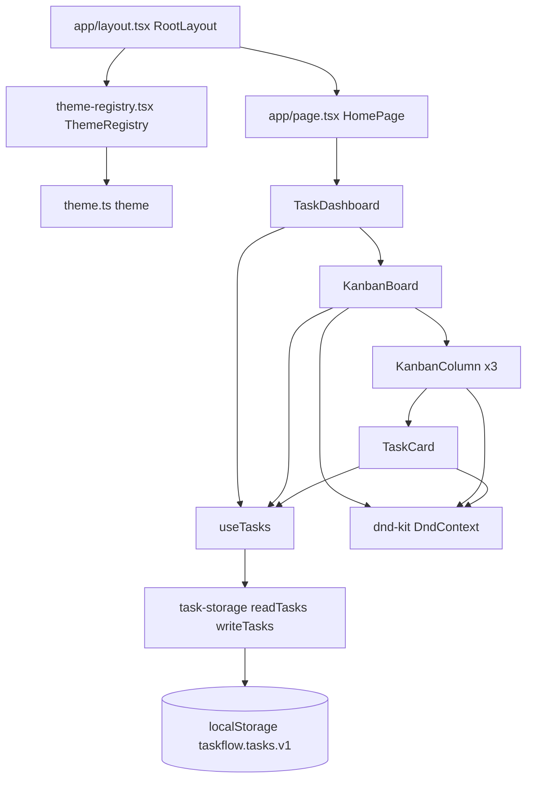
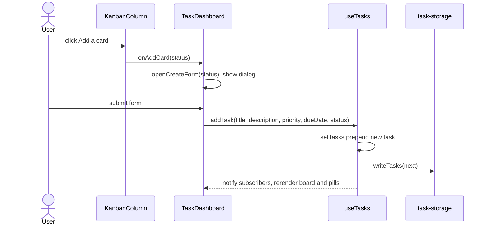
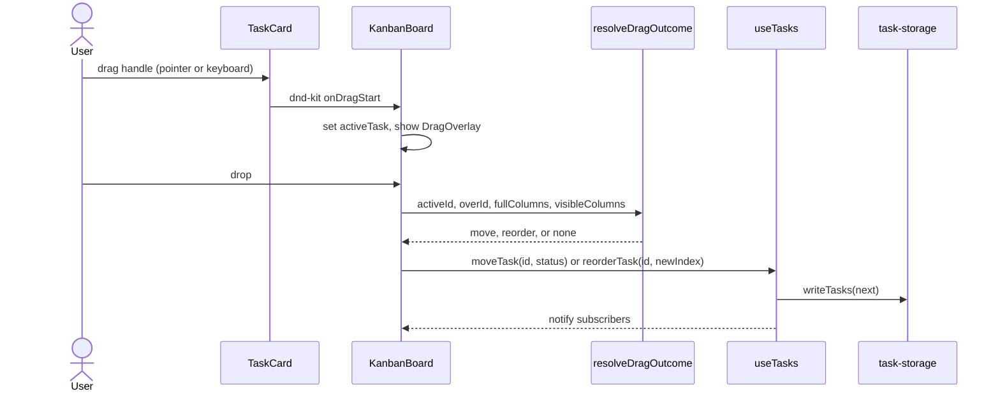
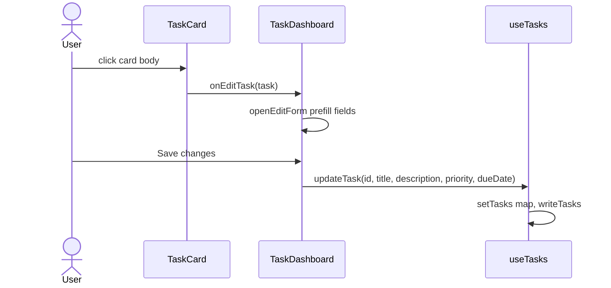

## Architecture Analysis

### System Overview

TaskFlow is a client-rendered Next.js 15 App Router application with one route (`/`). The server renders only the shell (`src/app/layout.tsx`, `src/app/page.tsx`); everything interactive is a `"use client"` component. State lives in a module-level external store inside `src/hooks/use-tasks.ts`, backed by `localStorage` through `src/lib/task-storage.ts`. UI is Material UI (emotion) with `@dnd-kit` for drag and drop.

### Architectural Style

Monolithic single-package front-end application with no backend. Evidence: no `src/app/api`, no route handlers, no server actions, no ORM or database driver; one `package.json`; one route.

Layered, acyclic dependency graph: `types -> lib -> hooks -> components -> app`, with `theme.ts -> theme-registry.tsx -> app/layout.tsx` as a parallel styling branch.

### Component Relationships

Text fallback: `RootLayout` wraps `HomePage` in `ThemeRegistry` (which supplies the MUI `theme`). `HomePage` renders `TaskDashboard`, which renders `KanbanBoard`, which renders three `KanbanColumn` components, each rendering `TaskCard` items. `TaskDashboard`, `KanbanBoard`, and `TaskCard` all call `useTasks`, which reads and writes `localStorage` through `task-storage`. `KanbanBoard`, `KanbanColumn`, and `TaskCard` use `@dnd-kit` hooks and context.

### Data Flow

1. First client render: `useSyncExternalStore` returns the empty server snapshot (`isReady: false`), so the dashboard shows "Loading your tasks...".
2. Effect in `useTasks` calls `loadOnce()`: reads `localStorage`; if empty, seeds four starter tasks and writes them; sets snapshot `isReady: true`.
3. Mutations (`addTask`, `updateTask`, `deleteTask`, `setStatus`, `moveTask`, `reorderTask`) go through `setTasks`, which writes to storage once ready and notifies all subscribers.
4. `KanbanBoard` derives `fullColumns` (ids by status in array order), `visibleColumns` (after search filter) and unfiltered `counts` from `tasks`.
5. Order within a column is the relative order of that status's tasks in the single flat array; there is no position field.

### Key Design Decisions

- External store with `useSyncExternalStore` and module-level state, so every `useTasks()` caller sees one shared task list (`src/hooks/use-tasks.ts`).
- Pure, exported `resolveDragOutcome` separates drag decision logic from DnD events; it maps filtered (visible) positions onto the full list (ADR-005 referenced in tests).
- Drag handle isolated on the card (`data-no-edit`) so card click opens edit, while controls and handle do not.
- SSR safety: `readTasks` and `writeTasks` guard on `typeof window === "undefined"`.
- MUI theme in `src/theme.ts` and emotion cache via `@mui/material-nextjs/v15-appRouter`.

### Improvement Opportunities

- Remove dead legacy CSS and unused Tailwind wiring.
- Validate and migrate stored data on read (currently a cast to `Task[]`).
- Split `TaskDashboard` (404 lines) into top bar, summary, and task dialog components.
- Add coverage reporting and a build and format check to CI.
- Refresh the README.

## Interaction Diagrams

### Create a task from a column

Text fallback: the user clicks "Add a card"; the column calls `onAddCard(status)`; the dashboard opens the dialog with that status; on submit it calls `addTask`; the hook prepends the task, writes the array through `writeTasks`, and notifies subscribers so the board and summary pills rerender.

### Drag a card to another column or position

Text fallback: dragging a card starts a `@dnd-kit` drag; on drop `KanbanBoard` calls `resolveDragOutcome` with the full and visible columns; a `move` outcome calls `moveTask`, a `reorder` outcome calls `reorderTask`, `none` does nothing; the hook persists via `writeTasks` and notifies subscribers.

### Edit a task

Text fallback: clicking the card body (outside any `data-no-edit` control) calls `onEditTask`; the dashboard prefills the dialog; saving calls `updateTask` with title, description, priority, and due date only, never status, and the hook persists the change.

### Cycle status and delete

Clicking the circular control calls `moveTask(id, nextStatus)` (todo -> in-progress -> done -> todo); clicking the trash icon calls `deleteTask(id)`. Both stop click propagation so the edit dialog does not open, and both persist through the same `setTasks` path.
