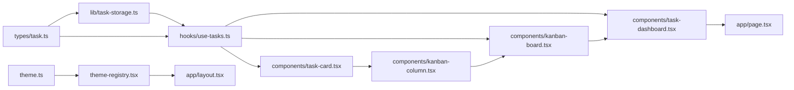

# Dependencies

External packages and versions are listed once in `technology-stack.md`; this file records how they are used and the internal graph.

## Internal Dependency Graph

Text fallback adjacency list:

- `task-storage.ts` -> `types/task`
- `use-tasks.ts` -> `lib/task-storage`, `types/task`, react
- `task-card.tsx` -> `hooks/use-tasks`, `types/task`, `@dnd-kit/sortable`, MUI, MUI icons
- `kanban-column.tsx` -> `components/task-card`, `types/task`, `@dnd-kit/core`, `@dnd-kit/sortable`, MUI, lucide-react
- `kanban-board.tsx` -> `hooks/use-tasks`, `components/kanban-column`, `types/task`, `@dnd-kit/core`, `@dnd-kit/sortable`, MUI
- `task-dashboard.tsx` -> `hooks/use-tasks`, `components/kanban-board`, `types/task`, MUI, lucide-react
- `page.tsx` -> `components/task-dashboard`
- `layout.tsx` -> `theme-registry`, `globals.css`, next types
- `theme-registry.tsx` -> `theme`, `@mui/material`, `@mui/material-nextjs`
- `theme.ts` -> `@mui/material/styles`

All internal imports use the `@/` alias. No circular references.

## External Dependency Usage

- **MUI** (material, icons-material, material-nextjs, emotion): all UI primitives and styling; `TaskCard` uses `@mui/icons-material`, the dashboard and column use `lucide-react`, so two icon libraries coexist.
- **@dnd-kit**: `core` provides `DndContext`, sensors, `DragOverlay`, `useDroppable`; `sortable` provides `useSortable`, `SortableContext`, `sortableKeyboardCoordinates`, `verticalListSortingStrategy`.
- **next**: App Router, `Metadata` type, `next/jest`.
- **tailwindcss/postcss/autoprefixer**: build-time only; Tailwind directives in `globals.css`.

## Test Dependencies

Jest, jsdom, Testing Library, user-event; tests mock or exercise `useTasks` and `localStorage` as described in `code-quality-assessment.md`.

## Version Observations

- `@mui/material` ^9.5.0 with `@mui/material-nextjs` v15 App Router entry point matches Next 15.
- `@dnd-kit/sortable` ^8.0.0 is paired with `@dnd-kit/core` ^6.1.0.
- Lockfile `pnpm-lock.yaml` is present; CI installs with `--frozen-lockfile`. No audit or outdated check was run (read-only scan).
