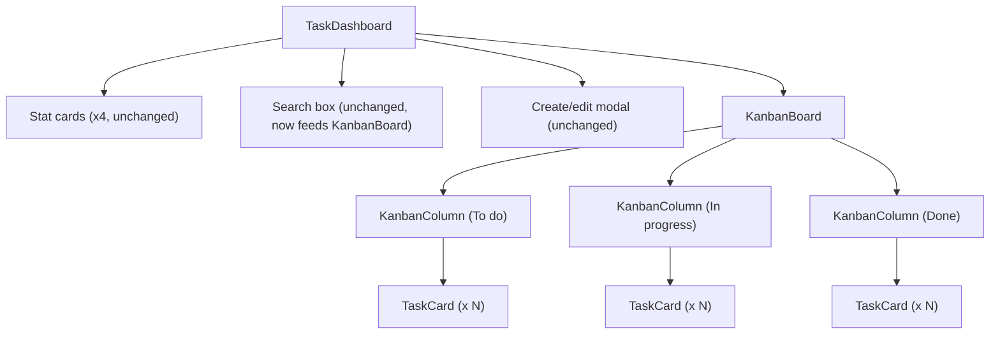

# Functional Design — u1-kanban-board — Frontend Components

## Component Hierarchy

<!-- Text fallback: TaskDashboard renders the unchanged stat cards, search
box, and create/edit modal, plus KanbanBoard. KanbanBoard renders exactly 3
KanbanColumn instances (To do, In progress, Done), each rendering one
TaskCard per card currently assigned to (and matching the search filter
for) that column. -->

## Props / State per Component

### TaskDashboard

- **State** (unchanged from today): `searchQuery: string`, `showForm: boolean`, `editingTask: Task | null`, create/edit form field values (`title`, `description`, `priority`, `dueDate`).
- **Reads**: `tasks` from `useTasks()`.
- **Renders**: the 4 stat cards (computed from `tasks`, unchanged), the search box (bound to `searchQuery`), the create/edit modal (bound to `showForm`/`editingTask`), and `KanbanBoard`.
- **Passes to `KanbanBoard`**: `tasks` (the full, unfiltered array), `searchQuery`, `onEditTask: (task: Task) => void` (opens the modal in edit mode, prefilled — sets `editingTask` and `showForm`).

### KanbanBoard

- **Props**: `tasks: Task[]`, `searchQuery: string`, `onEditTask: (task: Task) => void`.
- **Derived (no separate state)**: groups `tasks` into the 3 fixed status groups (and their unfiltered per-group totals, reusing the existing `counts.todo`/`counts.active`/`counts.done` computation — FR1.2), then separately filters each group independently by `searchQuery` for display (case-insensitive, title + description) — recomputed via `useMemo` on `[tasks, searchQuery]`, same pattern as today's `filteredTasks`/`counts`.
- **Owns**: the board's drag-and-drop session (via the library adopted in ADR-002 — specific API surface is a Code Generation concern, not named here), activated from each `TaskCard`'s drag handle by pointer or keyboard, and the drag-end handling that computes move vs. reorder (functional-spec.md W2/W3) and calls `useTasks().moveTask` / `reorderTask`.
- **Renders**: one `KanbanColumn` per fixed status, in fixed order (To do, In progress, Done), each receiving its own unfiltered `count`, its own filtered+ordered `Task[]` slice, the column's `label`, and `onEditTask`.

### KanbanColumn

- **Props**: `status: TaskStatus`, `label: string`, `count: number` (the column's total per-status count, unfiltered — FR1.2; NOT `tasks.length`, since that would reflect the search filter), `tasks: Task[]` (already filtered and ordered, for rendering cards only), `onEditTask: (task: Task) => void`.
- **State**: none.
- **Renders**: the column header (`label` + `count`, always the real unfiltered total), a drop-target container wrapping a vertically scrollable list of `TaskCard`, or an empty-state message (e.g. "No matching cards") when `tasks.length === 0` — the header and its count stay visible even then (functional-spec.md W6 step 3).

### TaskCard

- **Props**: `task: Task`, `onEditTask: (task: Task) => void`.
- **State**: none (purely derived from `task`).
- **Reads/calls**: `useTasks()` directly for `deleteTask(task.id)` and for the keyboard-cycle control's `moveTask(task.id, nextStatus)` (the existing `nextStatus` lookup table, unchanged).
- **Renders**: title, description preview (or "No description added"), priority badge, due date (or "No due date"), completed styling when `task.status === "done"` (no separate status-badge text), a drag handle operable by pointer or keyboard (library-provided, per ADR-002), the keyboard-operable status-cycle control (a separate element from the drag handle), and the delete control.
- **Interaction**: clicking the card outside the drag handle, cycle control, and delete control calls `onEditTask(task)`.

## Interaction Flows

See `functional-spec.md` workflows W1–W10 for the full numbered sequences
(load, drag between columns, reorder within a column, keyboard column
change, keyboard reorder, search, create, edit, delete, responsive
layout). This section adds only the UI-specific affordance detail those
workflows don't carry:

- **Drag handle focus/hover affordance (NFR3)**: every `TaskCard`'s drag
  handle shows a visible focus ring on keyboard focus and a hover
  affordance on pointer hover, so a keyboard or pointer user can always see
  where a drag would start from.
- **Valid drop target affordance (NFR3)**: a `KanbanColumn` currently
  targeted by an in-progress drag (pointer or keyboard) shows a visible
  highlight, so the person can see where a drop would land before
  committing it.
- **Tab order**: within a card, the drag handle, the keyboard-cycle
  control, and the delete control are each independently focusable and
  operable, in that left-to-right order, consistent with the card's visual
  layout.

## Form Validation Rules

Unchanged from today's create/edit form (no new validation introduced by
this Unit):
- `title`: required, non-empty after trimming whitespace; submission is
  blocked otherwise (unchanged existing rule).
- `description`, `priority`, `dueDate`: optional, no new constraints.
- The form carries no `status` field (FR7.3) — editing a task can never
  change its column.

## API Integration Points

None. This Unit is entirely client-side (NFR2): every interaction in
`functional-spec.md` calls a `useTasks()` method directly, which persists
through the existing `task-storage.ts` write-back-on-change effect into
`localStorage`. No network call, API route, or server action is
introduced.
