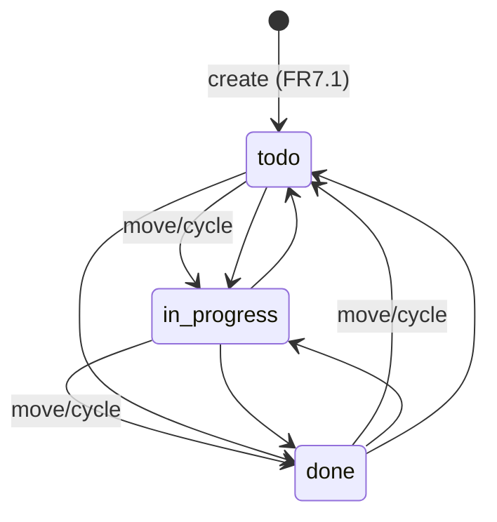
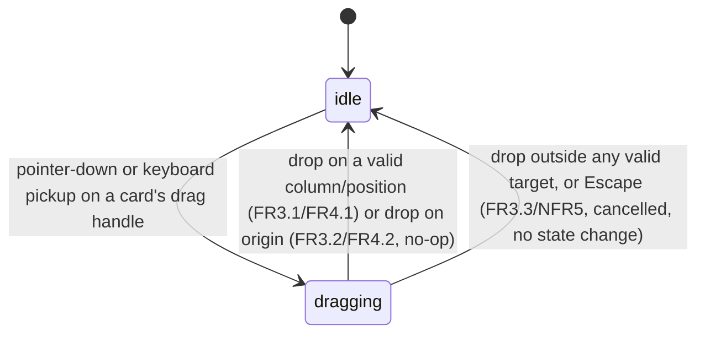

# Functional Design — u1-kanban-board — Functional Specification

This is a `ui`-kind Unit (Units Generation Q2): it produces no `entities.md`
or `rules.md` (`produces_kinds` excludes `ui` from both). This document is
self-contained — it specifies the interaction workflows and state
transitions authoritatively, from `unit-of-work.md` and `requirements.md`,
with no entity/rule document of its own. The `Task` entity's shape is
unchanged from Domain Design's `components.md` (owned by `useTasks`: `id`,
`title`, `description`, `status`, `priority`, `dueDate`, `createdAt` — see
Data Shape Reference below).

## State Model

### Task status (unchanged)

<!-- Text fallback: a task starts in todo on creation. From any status it
can move to any other status (drag-and-drop, FR3.1) or advance through the
fixed cycle todo -> in-progress -> done -> todo (status-cycle control,
FR5.2). Editing a task's other fields (FR7.3) never triggers a transition. -->

### Drag session (new — UI interaction state, not persisted)

<!-- Text fallback: a drag session starts when a card's drag handle is
activated by pointer or keyboard, and ends either by a valid drop (which
commits a move or reorder), a drop back on the origin (no-op), or a
cancellation (outside any valid target, or Escape) which leaves the task
list exactly as it was before the drag started. -->

## Workflows

### W1 — Load the board (FR1.3, NFR6)

1. `useTasks` reads the full task array from `task-storage` on mount (unchanged).
2. `KanbanBoard` groups the array into the 3 fixed status groups (todo, in-progress, done), preserving each task's existing relative position within its group.
3. `KanbanColumn` renders each group's header, live count, and cards.
4. No migration step runs and none is needed: every task's existing `status` and array position already fully determine its column and position (ADR-001).

### W2 — Drag a card to a different column (FR3.1, FR3.2, FR3.3, NFR5)

1. The person starts a drag on a card's drag handle with a pointer. Moving a
   card to a different column by keyboard is provided by W4's dedicated
   non-drag control, not by this drag session — a keyboard-driven drag
   session's reordering reach is same-column only (see W5); it is not relied
   on for cross-column moves.
2. `KanbanBoard`'s drag session tracks the current drop target column and position.
3. On drop over a different column: `KanbanBoard` calls `useTasks.moveTask(id, newStatus)`. The task's status updates and it is relocated to the end of its new status group in the underlying array (no separate order field, ADR-001).
4. On drop back in the originating column at the same position: no call is made (FR3.2) — status and position are unchanged.
5. On drop outside any valid column/card target, or on Escape: the drag session returns to idle with no call made (FR3.3) — the task list is exactly as it was before the drag started (NFR5).
6. Every call in step 3 flows through `useTasks`'s existing write-back-on-change effect into `task-storage` (NFR1) — no explicit "Save" step.

### W3 — Reorder a card within its column (FR4.1, FR4.2, FR4.3)

1. The person starts a drag on a card's drag handle, by pointer or by
   keyboard (picking the card up, moving it, and dropping it, all via
   keyboard — see W5; this is the same drag session as W2, scoped to one
   column).
2. On drop at a new position within the SAME column: `KanbanBoard` calls `useTasks.reorderTask(id, newIndex)`, computed against that column's full, unfiltered task list (ADR-005 — see W6 for the search-active case). The task's status is unchanged (FR4.2).
3. A newly created task is inserted via the existing `addTask` behaviour — prepended (newest-first) into the To do column — before any manual reordering is applied (FR4.3); this is unchanged from today's `addTask`.
4. The new order persists immediately via the same write-back-on-change effect as W2 step 6 (FR4.1).

### W4 — Keyboard-operate a column change without dragging (FR5.1, FR5.2)

1. Each `TaskCard` exposes a keyboard-operable control, equivalent to today's status-cycle button, separate from the drag handle.
2. Activating it calls `useTasks.moveTask(id, nextStatus)` with `nextStatus` computed from the existing fixed-cycle lookup (todo -> in-progress -> done -> todo), unchanged from today's behaviour (FR5.2).
3. This is a non-drag alternative to W2 — it never engages the drag session state.

### W5 — Keyboard-operate reordering (NFR3 resolution for in-column reordering)

This is the keyboard-driven drag path already described in W3 step 1,
called out as its own workflow because it was the gap the Domain Design
review (R-00, Major) identified: FR5 only describes a dedicated control for
column changes (W4), but NFR3 also requires a keyboard-operable equivalent
for reordering. Resolution: the drag-and-drop library already adopted for
this Unit (ADR-002) supports a keyboard-driven drag session — a focused
card's drag handle can be picked up, moved, and dropped by keyboard alone,
within its own column (reorder), exactly as W3 describes, with no separate
control or new component needed. This is a keyboard-operated drag, not a
mouse-only one, so it satisfies NFR3 for this interaction the same way W4's
dedicated control satisfies it for column changes. Scope note: this
keyboard-driven session is relied on for SAME-COLUMN reordering only; W2
step 1 already says cross-column keyboard moves go through W4 instead, so
NFR3 does not depend on keyboard dragging working across columns.

### W6 — Search filtering per column (FR6.1, FR6.2)

1. `TaskDashboard` holds the search query (unchanged location of this state).
2. `KanbanBoard` filters each status group independently by the query (case-insensitive, matching title and description — the same matching rule as today).
3. `KanbanColumn` renders only its filtered cards. Its header's live count is NOT affected by the search filter: FR1.2 says the count reuses the existing per-status counts already computed today (`counts.todo`/`counts.active`/`counts.done`), which the current codebase computes from the full, unfiltered task list — the same totals already shown in the unchanged stat cards (FR8.1). So a column keeps showing its real total count even while filtered to zero visible cards, with an empty-state message in place of cards in that case. This also settles the open question Requirements Analysis left (R-02): the column header and its (unfiltered) count are always visible; only the card list beneath it empties out.
4. The old status-filter tabs (All tasks / To do / In progress / Completed) are removed from `TaskDashboard` entirely (FR6.2) — the 3 fixed columns now provide that grouping.
5. Reordering (W3) while a column is filtered: the drop position is computed against the column's full, unfiltered list using the drop target's nearest VISIBLE neighbors to find the insertion point (ADR-005) — hidden, non-matching cards keep their relative position.

### W7 — Create a task (FR7.1)

1. Unchanged: the existing "New task" button opens the existing create-task form (now rendered by `TaskDashboard`, same as today).
2. On submit, `useTasks.addTask(...)` creates the task with status `todo` (unchanged business rule), appearing in the To do column (W3 step 3).

### W8 — Edit a task (FR7.2, FR7.3)

1. Clicking a `TaskCard` outside its drag handle, keyboard-cycle control (W4), and delete control opens the existing edit form, prefilled with that task's current field values (unchanged form, now opened from `TaskCard` instead of `TaskRow`).
2. Submitting calls the existing `useTasks.updateTask(...)` (unchanged) — the form has no status field, so editing never moves the card to a different column (FR7.3).

### W9 — Delete a task (FR2.3)

1. `TaskCard`'s delete control calls `useTasks.deleteTask(id)` immediately, with no confirmation step — unchanged from today's delete button.

### W10 — Responsive layout (FR9.1, FR9.2)

1. A column whose rendered cards exceed its available height scrolls vertically within that column; its header and the other columns remain visible (FR9.1) — unchanged responsive mechanism, applied per-column instead of to one shared list.
2. On narrow/mobile viewports, the 3 columns are presented in a horizontally scrollable row, consistent with the app's existing responsive breakpoints (FR9.2).

## Data Shape Reference (not a new source of truth)

The `Task` entity is unchanged from Domain Design's `components.md` (owned
by `useTasks`): `id`, `title`, `description`, `status`
(`"todo" | "in-progress" | "done"`), `priority`
(`"low" | "medium" | "high"`), `dueDate`, `createdAt`. No field is added or
removed by this Unit (ADR-001 — ordering stays implicit via array position).
