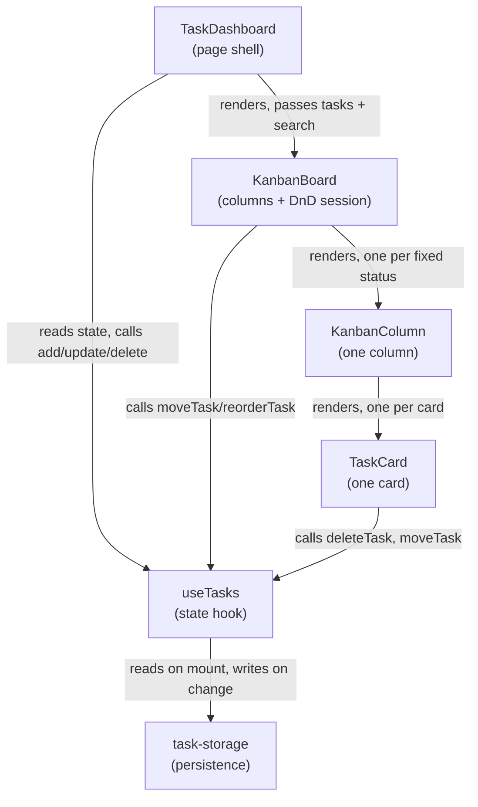

# Domain Design — Component Catalogue

## Part A — Machine-Readable Catalogue

```yaml
components:
  - name: TaskDashboard
    summary: Page-level shell composing the board, stat cards, search, and the create/edit task modal.
    behaviour: >
      Owns transient UI state (search query, modal visibility/mode, form
      field values). Computes the four summary stat values from task state,
      unchanged (FR8.1). Renders KanbanBoard with the current task list and
      search query. Opens the create-task modal via "New task" (FR7.1) and
      the edit modal when a card's edit affordance is used, prefilled with
      that task's current fields (FR7.2); editing through that form never
      changes a task's status (FR7.3). Does not own column layout,
      drag-and-drop behaviour, or per-column filtering.
    responsibilities:
      - Render the 4 summary stat cards
      - Render the search box and hold the search query state
      - Render and manage the create/edit task modal (reused unchanged)
      - Compose KanbanBoard, passing it the full task list and search query
    depends_on:
      - component: KanbanBoard
        interaction: renders the 3-column board for the current tasks and search query
        style: sync
      - component: useTasks
        interaction: reads task state and calls addTask/updateTask/deleteTask for modal actions
        style: sync
    dependents: []
    external_dependencies: []
    entities: []

  - name: KanbanBoard
    summary: Lays out the three fixed status columns and hosts the drag-and-drop session for the whole board.
    behaviour: >
      Groups the tasks it receives into the three fixed status groups (To
      do, In progress, Done; FR1.1), preserving each group's existing
      relative order. Filters each group independently by the current
      search query (FR6.1), keeping every group's header and count visible
      even when its filtered result is empty. Owns the drag-and-drop
      session for the whole board: on a completed drag, determines whether
      the drop changed the task's column (calls useTasks.moveTask, FR3.1)
      or only its position within the same column (calls
      useTasks.reorderTask, FR4.1/FR4.2), computing the resulting index
      against the column's full unfiltered list using the drop target's
      nearest visible neighbors when a search filter narrows that column
      (Q5). Dropping back into the same column at the same position leaves
      status unchanged (FR3.2). A drag that ends outside a valid column or
      card target is a no-op: neither method is called, so no partial or
      corrupted state is ever written (FR3.3, NFR5).
    responsibilities:
      - Render the 3 fixed KanbanColumn instances in a fixed order
      - Own the drag-and-drop session/context for the whole board
      - Decide move vs. reorder from a drag's source/target columns, and compute the resulting index
    depends_on:
      - component: KanbanColumn
        interaction: renders one column's header, count, and cards, and exposes it as a drop target
        style: sync
      - component: useTasks
        interaction: calls moveTask/reorderTask to persist the result of a completed drag
        style: sync
    dependents:
      - component: TaskDashboard
        interaction: rendered by TaskDashboard with the current task list and search query
    external_dependencies:
      - name: "@dnd-kit/core + @dnd-kit/sortable"
        kind: other
        purpose: drag-and-drop primitives, including the built-in keyboard sensors used for the FR5/NFR3 non-drag alternative
    entities: []

  - name: KanbanColumn
    summary: Renders one fixed status column — its header, live count, and scrollable card list.
    behaviour: >
      Renders the column label and a live count of the cards currently in
      it (FR1.2), and a vertically scrollable list of TaskCard that scrolls
      within the column while the header and the other columns stay
      visible (FR9.1). Shows only the cards KanbanBoard has already
      filtered for it by the current search query; a column with zero
      matches still renders its header and count, with an empty-state
      message in place of cards (FR6.1). Exposes itself as a droppable
      region to KanbanBoard.
    responsibilities:
      - Render the column header, label, and live count
      - Render the scrollable card list for this column
      - Render an empty-state message when the column's filtered card list is empty
    depends_on:
      - component: TaskCard
        interaction: renders each card in this column
        style: sync
    dependents:
      - component: KanbanBoard
        interaction: rendered once per fixed status by KanbanBoard
    external_dependencies: []
    entities: []

  - name: TaskCard
    summary: Renders a single task as a draggable, keyboard-operable card.
    behaviour: >
      Renders the same fields as today's task row — title, description
      preview or "No description added", priority badge, and due date or
      "No due date" (FR2.1) — with completed styling when its task's
      status is done and no separate status-badge text, since the column
      now conveys status (FR2.2). Keeps the existing immediate,
      no-confirmation delete control (FR2.3). Exposes a drag handle for
      KanbanBoard's drag-and-drop session, plus a keyboard-operable control
      equivalent to today's status-cycle button (FR5.1) that advances the
      task through the fixed cycle todo -> in-progress -> done -> todo
      without requiring a drag (FR5.2). Clicking the card outside its
      controls opens the existing edit form, prefilled (FR7.2).
    responsibilities:
      - Render one card's fields and controls
      - Provide a drag source for KanbanBoard's drag-and-drop session
      - Provide the keyboard-operable non-drag column-change control
      - Provide the delete control
    depends_on:
      - component: useTasks
        interaction: calls deleteTask, and moveTask for the non-drag status-cycle action
        style: sync
    dependents:
      - component: KanbanColumn
        interaction: rendered once per card in that column
    external_dependencies: []
    entities: []

  - name: useTasks
    summary: Single state-owning hook for all task data — unchanged ownership, extended with board operations.
    behaviour: >
      Remains the sole owner of task state and the single place that
      mutates it (NFR1), per the existing architecture. Keeps the existing
      addTask/updateTask/deleteTask/setStatus. Adds moveTask(id,
      newStatus) — sets the task's status and relocates it within the
      underlying array to its new status group, with no new persisted
      field (Q1) — and reorderTask(id, newIndex) — splices the task to a
      new index among tasks of its own current status only, leaving tasks
      of other statuses untouched (FR4.1, FR4.2). Every task already in
      storage renders in the column matching its current status the first
      time the board loads after this change, with no migration step
      (FR1.3, NFR6), because status and array order already fully
      determine the new column structure. Every mutation continues to flow
      through the existing write-back-on-change effect into task-storage
      (NFR1); an operation that does not complete calls neither new method,
      so no partial state is ever set (FR3.3, NFR5).
    responsibilities:
      - Own the in-memory Task[] state and its initial load/seed behaviour (unchanged)
      - Persist every mutation via the existing write-back effect
      - Expose addTask, updateTask, deleteTask, setStatus (unchanged) and the new moveTask, reorderTask
    depends_on:
      - component: task-storage
        interaction: reads tasks on mount, writes the full array on every change
        style: sync
    dependents:
      - component: TaskDashboard
        interaction: reads task state; calls addTask/updateTask/deleteTask for modal actions
      - component: KanbanBoard
        interaction: calls moveTask/reorderTask after a completed drag
      - component: TaskCard
        interaction: calls deleteTask and the non-drag status-cycle action
    external_dependencies: []
    entities:
      - name: Task
        identifier: id
        attributes: [id, title, description, status, priority, dueDate, createdAt]
        references: []

  - name: task-storage
    summary: Sole persistence boundary — SSR-safe read/write of the full task array to localStorage. Unchanged by this feature.
    behaviour: >
      Reads and writes the complete Task[] array to localStorage under the
      existing key, guarded for the Next.js SSR pass where window does not
      exist, with defensive try/catch on both paths (NFR2). This feature
      introduces no new field and no new storage key, so no migration is
      needed (NFR6).
    responsibilities:
      - Read the stored task array (or return [] on the server/empty storage)
      - Write the full task array on every change
    depends_on: []
    dependents:
      - component: useTasks
        interaction: the only caller of readTasks/writeTasks
    external_dependencies:
      - name: localStorage (Web Storage API)
        kind: other
        purpose: sole datastore for the application's task list, key taskflow.tasks.v1 — unchanged
    entities: []
```

Well-formedness check: every component name is unique; every `component:`/
`owned_by` referenced above (`TaskDashboard`, `KanbanBoard`, `KanbanColumn`,
`TaskCard`, `useTasks`, `task-storage`) is declared; no component depends on
itself; every `depends_on` edge has a matching `dependents` edge on the
other side; `Task` is owned by exactly one component (`useTasks`) and has an
identifier (`id`); the dependency graph is acyclic
(`TaskDashboard`/`KanbanBoard` -> `KanbanColumn` -> `TaskCard` -> `useTasks`
-> `task-storage`, with `TaskDashboard` and `KanbanBoard` also depending on
`useTasks` directly — no edge points back up the chain).

## Part B — Human-Readable View

### Component Diagram



<!-- Text fallback: TaskDashboard renders KanbanBoard (passing the task
list and search query) and reads/writes task state via useTasks for its
modal actions. KanbanBoard renders the 3 fixed KanbanColumn instances and
calls useTasks.moveTask/reorderTask after a completed drag. KanbanColumn
renders one TaskCard per card. TaskCard calls useTasks.deleteTask and
useTasks.moveTask (for its non-drag status-cycle control). useTasks reads
from and writes to task-storage, which is the sole caller of
localStorage. -->

### Component Summary

| Component | Purpose | Depends On | Dependents | Entities Owned |
|---|---|---|---|---|
| TaskDashboard | Page shell: stats, search, create/edit modal, composes the board | KanbanBoard, useTasks | (none) | (none) |
| KanbanBoard | 3-column layout + drag-and-drop session | KanbanColumn, useTasks | TaskDashboard | (none) |
| KanbanColumn | One column's header, count, and card list | TaskCard | KanbanBoard | (none) |
| TaskCard | One card's fields, drag handle, keyboard control, delete | useTasks | KanbanColumn | (none) |
| useTasks | Single state-owning hook for all task data | task-storage | TaskDashboard, KanbanBoard, TaskCard | Task |
| task-storage | SSR-safe localStorage read/write (unchanged) | (none) | useTasks | (none) |

### Entity Ownership

| Entity | Owning Component | Identifier | Attributes | References |
|---|---|---|---|---|
| Task | useTasks | id | title, description, status, priority, dueDate, createdAt | (none) |

### External Dependencies

| Component | Dependency | Kind | Purpose |
|---|---|---|---|
| KanbanBoard | @dnd-kit/core + @dnd-kit/sortable | other (DnD library) | Drag-and-drop primitives with built-in keyboard sensors (FR5/NFR3) |
| task-storage | localStorage (Web Storage API) | other (browser storage) | Sole datastore for the task list, key `taskflow.tasks.v1` — unchanged |

### Rationale

| Component | Why a separate building block |
|---|---|
| TaskDashboard | Distinct concern (page-level composition, stats, search, modal) from board rendering; existing code, kept as the thin shell per Q3 |
| KanbanBoard | Distinct lifecycle: owns the drag-and-drop session and move/reorder decision logic, which no other component needs to know about |
| KanbanColumn | Distinct concern: per-column header/count/empty-state/scroll, repeated 3 times with no shared mutable state between instances |
| TaskCard | Distinct change rate: card presentation and per-card controls change independently of column or board layout, and need isolated testing (replaces TaskRow) |
| useTasks | Unchanged: remains the single data-owning boundary; extending it in place avoids introducing a second place that can mutate Task state |
| task-storage | Unchanged: sole persistence boundary; this feature does not touch it, so it stays a separate, untouched building block |
